# CampoAlto — mantenimiento de la flota

Diseño de la arquitectura de la aplicación de mantenimiento de CampoAlto S.A.S. El taller está en Palmira desde 2021. Fumiga caña en el Valle y arroz en Tolima. La flota es propia: 16 Agras T50 y 8 Agras T40. El cliente paga la hectárea. No contrata el mantenimiento y no se reparan drones ajenos.

Integrantes: Nicolás Agudelo, Nicolás Buitrago, Esteban Alvarez, Sebastian Bedoya. El diseño no está partido por persona. Cualquiera de los cuatro tiene que poder explicar la entrevista, cada vista y el porqué de lo que quedó fuera.

El modelo se abre en Archi con **Archivo → Abrir** sobre [modelo/CampoAlto-Mantenimiento.archimate](modelo/CampoAlto-Mantenimiento.archimate). Las vistas están dentro del modelo. Las imágenes de este documento están en [vistas](vistas).

La decisión que no puede fallar es soltar el vuelo. Motor, bomba, batería y electrónica no salen porque el técnico firmó, porque el lote ya está prometido o porque el piloto quiere terminar. Si el jefe no da el visto bueno, el dron se queda en tierra.

## Índice

1. [Contexto y entrevista](#1-contexto-y-entrevista)
2. [Motivación](#2-motivacion)
   - [V1 Motivación](#v1-motivacion)
3. [Mapa de capacidades y proceso E2E](#3-mapa-de-capacidades-y-proceso-e2e)
   - [V2 Mapa de capacidades](#v2-mapa-de-capacidades)
   - [V3 Cadena de valor y proceso E2E](#v3-cadena-de-valor-y-proceso-e2e)
4. [Descomposición de servicios](#4-descomposicion-de-servicios)
   - [V4 Descomposición de servicios](#v4-descomposicion-de-servicios)
   - [V4b Contratos de plataforma y dominio](#v4b-contratos-de-plataforma-y-dominio)
   - [V4c Contratos de las capas 4 a 7](#v4c-contratos-de-las-capas-4-a-7)
5. [Dominios y lenguaje ubicuo](#5-dominios-y-lenguaje-ubicuo)
   - [V5 Dominios](#v5-dominios)
   - [V7 Lenguaje ubicuo](#v7-lenguaje-ubicuo)
6. [Agregados, comandos y eventos](#6-agregados-comandos-y-eventos)
   - [V6a Soltar el vuelo](#v6a-soltar-el-vuelo)
   - [V6b Intervención y orden](#v6b-intervencion-y-orden)
   - [V6c Horas de vuelo](#v6c-horas-de-vuelo)
   - [V6d Baterías](#v6d-baterias)
   - [V6e Indicadores del día](#v6e-indicadores-del-dia)
   - [V6f Retención y expediente](#v6f-retencion-y-expediente)
   - [V6g Pedido de repuesto](#v6g-pedido-de-repuesto)
   - [V6h Plan y despiece](#v6h-plan-y-despiece)
   - [V6i Identidad T40/T50](#v6i-identidad-t40t50)
7. [Mapa de contextos e interoperabilidad](#7-mapa-de-contextos-e-interoperabilidad)
   - [V8 Mapa de contextos](#v8-mapa-de-contextos)
   - [V9 Interoperabilidad y anticorrupción](#v9-interoperabilidad-y-anticorrupcion)
8. [Bounded Context Canvas](#8-bounded-context-canvas)
   - [V11 Canvas](#v11-canvas)
9. [Decisiones y supuestos](#9-decisiones-y-supuestos)
   - [V10 Trazabilidad vertical](#v10-trazabilidad-vertical)
   - [Aportes](#aportes)

## 1. Contexto y entrevista

El guion, la instrucción de rol, la conversación y el análisis de hallazgos están en [entrevista](entrevista).

| Pieza | Archivo |
|---|---|
| Instrucción de rol | [entrevista/instruccion-de-rol.md](entrevista/instruccion-de-rol.md) |
| Guion, con el bloque de interoperabilidad | [entrevista/guion.md](entrevista/guion.md) |
| Conversación exportada | [entrevista/conversacion.md](entrevista/conversacion.md) |
| Qué se aceptó, qué se descartó y cómo cambió el diseño | [entrevista/analisis.md](entrevista/analisis.md) |

CampoAlto no tiene un sistema de mantenimiento. Lleva las horas en la hoja «Control de flota», la orden en papel, la foto en OneDrive, la novedad en el grupo «Novedades campo» y la lista en el grupo «Programa». La app del Agras es el origen de las horas, el caudal y la alerta de batería. Operaciones mira FlightHub para saber dónde está el equipo. Siigo guarda la factura. El software nuevo no reemplaza ninguno de esos.

Se aceptó diseñar el software del taller alrededor de una sola decisión: soltar el vuelo. Se descartó programar fincas, facturar hectáreas, inventar existencia o costo, hablar con el portal de la Aeronáutica, revisar la dosis del ICA, llevar una habilitación que no existe y publicar un indicador en cero cuando el dato no está. El detalle de cada descarte está en el análisis.

## 2. Motivación

### V1 Motivación

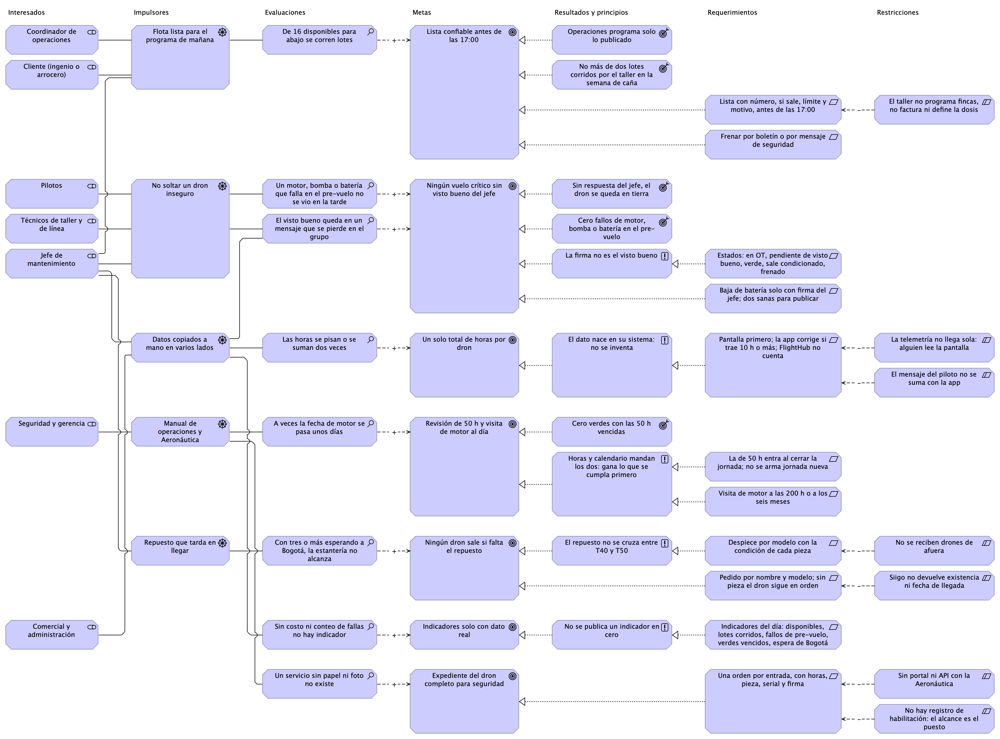

La vista responde por qué existe la aplicación. Son siete franjas, una por meta. En cada franja la relación es horizontal: interesado, impulsor, evaluación, meta, resultado o principio, requerimiento y restricción. Así la flecha no cruza el dibujo. El jefe toca varias franjas porque él suelta el vuelo, pide el repuesto y publica la lista; esas tres asociaciones bajan por el costado y no se mezclan con las horizontales.

| Franja | De dónde sale | Meta |
|---|---|---|
| Lista | Coordinador y cliente. Con caña y arroz abiertos, de 16 disponibles para abajo se corren lotes | Lista confiable antes de las 17:00. Operaciones programa solo lo publicado |
| Visto bueno | Pilotos, técnicos y jefe. Un motor que falla en el pre-vuelo no se vio en la tarde, y el visto bueno se pierde en el grupo | Ningún vuelo crítico sin visto bueno del jefe. Sin respuesta, el dron se queda en tierra |
| Horas | La misma cifra vive en la hoja, la app y el mensaje | Un solo total de horas por dron. El dato nace en su sistema: no se inventa |
| Plan | Seguridad y el manual. La fecha de motor a veces se pasa unos días | Revisión de 50 h y visita de motor al día. Cero verdes con las 50 h vencidas |
| Pieza | Lo que no se recupera en Palmira se pide a Bogotá, una a tres semanas | Ningún dron sale si falta el repuesto. El repuesto no se cruza entre T40 y T50 |
| Indicador | Comercial. El costo está en Siigo y las fallas en papeles | Indicadores solo con dato real. No se publica un indicador en cero |
| Expediente | Un servicio sin papel ni foto no existe | Expediente del dron completo para seguridad. Una orden por entrada |

La firma del técnico no es el visto bueno: ese principio realiza la meta del visto bueno, y el requerimiento de los estados (en OT, pendiente, verde, condicionado, frenado) realiza el principio. La baja de la batería realiza la misma meta, porque sin dos sanas del modelo el dron no entra a la lista. Horas y calendario mandan los dos: gana lo que se cumpla primero, y de ahí salen la revisión al cerrar la jornada y la visita a las 200 h o a los seis meses. El taller no programa fincas ni factura: esa restricción empuja en contra de meter en la lista algo que no es del taller.

## 3. Mapa de capacidades y proceso E2E

### V2 Mapa de capacidades

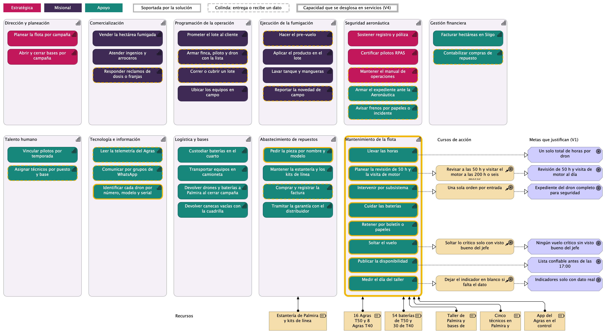

El mapa es el negocio completo, no solo el taller. Hay once capacidades de primer nivel y, adentro, las de segundo. El color es el del mapa de capacidades del curso: rosado estratégica, morado misional, verde apoyo. El borde dorado continuo es lo que la solución soporta. El borde dorado punteado colinda: entrega o recibe un dato y el trabajo sigue siendo de otra área. El borde grueso es Mantenimiento de la flota, que se desglosa en servicios en V4.

Mantenimiento es de apoyo. El cliente compra la hectárea fumigada, no el taller. Pasa lo mismo que con el mantenimiento de una IPS: sostiene la operación y no es lo que se le factura al cliente.

| La solución la soporta | Colinda | No la toca |
|---|---|---|
| Llevar las horas, planear 50 h y motor, intervenir, cuidar baterías, retener, soltar el vuelo, publicar la lista, medir el día | Reclamo de dosis, armar la finca con la lista, correr un lote, pre-vuelo, novedad de campo, manual, expediente, aviso de freno, costo del repuesto, puesto del técnico, telemetría, grupos de WhatsApp | Vender la hectárea, prometer el lote, ubicar en FlightHub, aplicar y lavar, registro y póliza, facturar, pilotos de temporada, cuarto de baterías, transporte, garantía |

Los recursos y los cursos de acción están al lado de Mantenimiento, no en una fila suelta. La flota, las baterías, las bases, los técnicos y la app se asignan a mantener la flota. La estantería se asigna a abastecer. Cada curso de acción realiza la capacidad y la meta de V1: 50 h y 200 h o seis meses, una sola orden, visto bueno del jefe, indicador en blanco si falta el dato. Pedir por nombre y modelo, sin código de bodega, está en el modelo aunque no cabe al lado del mapa: realiza la meta de la pieza.

### V3 Cadena de valor y proceso E2E

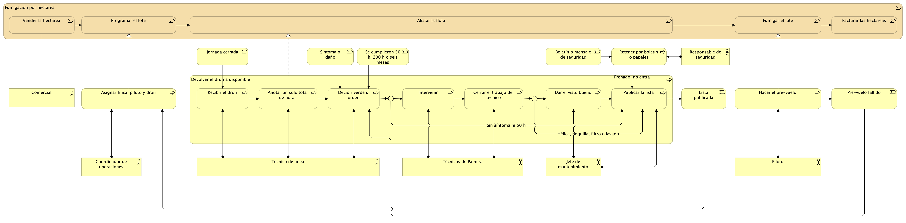

La cadena de valor es la fumigación por hectárea: vender, programar el lote, alistar la flota, fumigar y facturar. El proceso de punta a punta del taller vive dentro de alistar la flota. Pre-vuelo y asignación de la finca pertenecen a otras etapas y están fuera de esa caja.

El camino de la tarde es una fila: recibir el dron, anotar un solo total, decidir verde u orden, intervenir, cerrar el trabajo, dar el visto bueno y publicar la lista. Hay dos uniones OR.

- Después de decidir: si hay síntoma o se cumplieron 50 h, 200 h o seis meses, se interviene. Si no hay síntoma ni 50 h, el atajo va a publicar.
- Después de cerrar: hélice, boquilla, filtro o lavado pueden ir a publicar. Motor, bomba, batería y electrónica pasan por el visto bueno.

Los eventos quedan arriba del paso que disparan. La jornada cerrada abre la recepción. El síntoma y el cumplimiento de horas vuelven a la decisión. El boletín abre la retención, y un frenado no entra a la lista. Publicar produce la lista publicada, y con esa lista el coordinador asigna la finca. El pre-vuelo fallido vuelve a la decisión al día siguiente: no es un paso de dejar el dron disponible.

El técnico de línea recibe, anota y decide. Palmira interviene y cierra. El jefe da el visto bueno y publica. Seguridad retiene. El piloto hace el pre-vuelo. El coordinador asigna. Comercial está en vender, no en el taller.

## 4. Descomposición de servicios

El proceso se bajó en las siete capas de la jerarquía de servicios del curso. El enunciado pide al menos cuatro. Las tres de más son la anticorrupción, los datos maestros y la infraestructura: sin ellas el taller volvería a copiar a mano lo que ya vive en otro sistema, o a cruzar el T40 con el T50.

| Capa | Qué hay | Por qué ese corte |
|---|---|---|
| 1. Proceso de punta a punta | Recibir, anotar horas, decidir, intervenir, cerrar, visto bueno, publicar | Es el camino de la tarde. Lo hace el equipo del taller |
| 2. Plataforma | Cierre de jornada, mantenimiento por subsistema, liberación del vuelo, publicación de la disponibilidad | Los cuatro resultados que el jefe reconoce. Cada uno sirve a los pasos de arriba |
| 3. Dominio | Horas, plan y despiece, órdenes, pedidos, baterías, retenciones, disponibilidad, indicadores | Un servicio por subdominio. Sirven a la plataforma |
| 4. Básicos de Soltar el vuelo | Órdenes críticas, visto bueno, condicionado, dos baterías, corte de las cinco, devolver por pre-vuelo | Lo mínimo del subdominio central. Los seis sirven a Gestión de la disponibilidad |
| 5. Anticorrupción | Agras, novedad, recuento del lunes, lista, lote corrido, pedido, llegada, costo, boletín, freno, carpeta, probeta | Traducen el dato de afuera al idioma del taller, y al revés |
| 6. Datos maestros | Drones, despiece, catálogo, puestos, bases | Los comparten varios dominios. No deciden el verde |
| 7. Infraestructura | Permisos por puesto, avisos a los grupos, auditoría, fotos de la orden | Apoyo. No son un proceso del taller |

Hélice, boquilla, filtro y lavado los cierra el técnico de línea y él mismo puede dejar el dron en verde. Motor, bomba, batería y electrónica quedan pendientes hasta el visto bueno. Esa diferencia no abre otro servicio: es una regla de la liberación del vuelo.

### V4 Descomposición de servicios

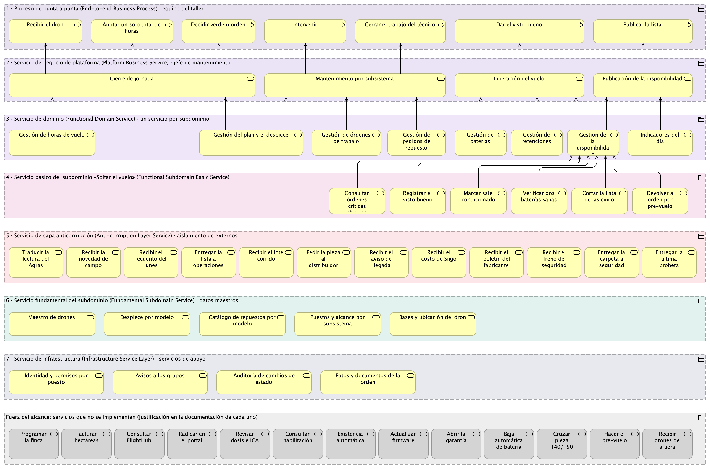

Cada banda es una capa. La flecha de servir sube: el servicio de abajo le presta el comportamiento al de arriba. Los seis básicos entran a Gestión de la disponibilidad porque esa es la decisión. Las capas 5, 6 y 7 no se cruzan con flechas en el dibujo: cada una sirve a varios dominios y la madeja tapaba los nombres. Esas relaciones están en el modelo.

Abajo, en gris, está lo que no se implementa. No tiene flecha hacia arriba a propósito.

| No se implementa | Por qué |
|---|---|
| Programar la finca | Lo hace el coordinador. A él le basta número, si sale y el límite |
| Facturar hectáreas | Comercial, en Siigo, después del vuelo. La factura no suelta el dron |
| Consultar FlightHub | Operaciones mira la ubicación. El taller no lo usa para horas ni disponibilidad |
| Radicar en el portal | Cerrar la orden no radica nada. Lo arma seguridad, aparte |
| Revisar dosis e ICA | La dosis la pone el agrónomo. No entra al verde |
| Consultar habilitación | No existe ese registro. El alcance es el puesto |
| Existencia automática | Se ve en la estantería o la dice la base. Siigo no la devuelve |
| Actualizar firmware | Lo hace el técnico si el jefe lo autorizó. El software no lo instala |
| Abrir la garantía | El preventivo no abre ese trámite. El trámite no suelta el vuelo |
| Baja automática de batería | A los 500 ciclos se propone. La baja la firma el jefe |
| Cruzar pieza T40/T50 | El repuesto no se cruza. El T50 no sale con una sola bomba |
| Hacer el pre-vuelo | Es de la madrugada, ya asignado. Si falla lo crítico, el dron vuelve a orden |
| Recibir drones de afuera | Comercial dice que no. Registro, póliza y repuesto son de estos 24 |

### V4b Contratos de plataforma y dominio

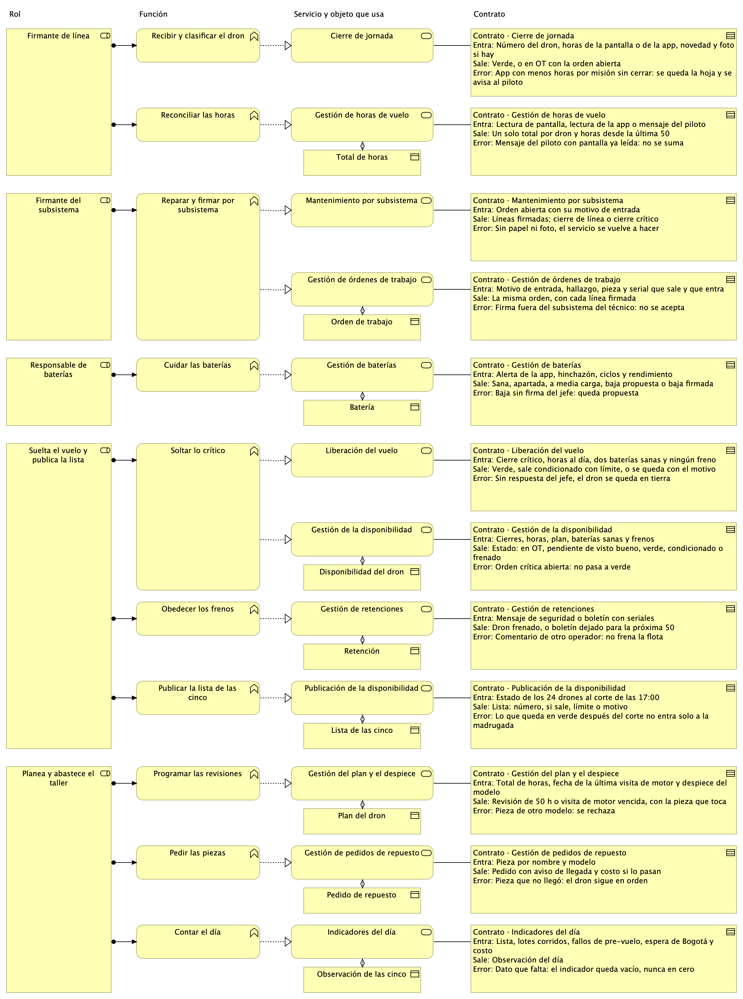

El contrato se escribe antes de la aplicación. Cada fila es rol, función, servicio y contrato. El contrato muestra entra, sale y error. Al lado, cuando el servicio guarda algo, está el objeto de negocio.

| Rol | Servicio | Entra | Sale | Error |
|---|---|---|---|---|
| Firmante de línea | Cierre de jornada | Número, horas, novedad y foto si hay | Verde, o en OT con la orden abierta | App con menos horas por misión sin cerrar: se queda la hoja |
| Firmante de línea | Gestión de horas | Pantalla, app o mensaje | Un solo total y horas desde la última 50 | Mensaje con pantalla ya leída: no se suma |
| Firmante del subsistema | Mantenimiento por subsistema | Orden abierta y su motivo | Líneas firmadas; cierre de línea o cierre crítico | Sin papel ni foto, el servicio se vuelve a hacer |
| Firmante del subsistema | Gestión de órdenes | Hallazgo, pieza y serial | La misma orden, con cada línea firmada | Firma fuera del subsistema: no se acepta |
| Responsable de baterías | Gestión de baterías | Alerta, hinchazón, ciclos y rendimiento | Sana, apartada, media carga, propuesta o baja firmada | Baja sin firma del jefe: queda propuesta |
| Suelta el vuelo | Liberación del vuelo | Cierre crítico, horas al día, dos baterías y ningún freno | Verde, condicionado con límite, o se queda con el motivo | Sin respuesta del jefe, se queda en tierra |
| Suelta el vuelo | Gestión de la disponibilidad | Cierres, horas, plan, baterías y frenos | en OT, pendiente, verde, condicionado o frenado | Orden crítica abierta: no pasa a verde |
| Suelta el vuelo | Gestión de retenciones | Mensaje de seguridad o boletín | Frenado, o boletín dejado para la próxima 50 | Comentario de otro operador: no frena |
| Suelta el vuelo | Publicación | Estado de los 24 a las 17:00 | Número, si sale, límite o motivo | Lo de después del corte no entra solo a la madrugada |
| Planea el taller | Plan y despiece | Horas, fecha de motor y despiece | Revisión vencida, con la pieza que toca | Pieza de otro modelo: se rechaza |
| Planea el taller | Pedidos | Pieza por nombre y modelo | Pedido, aviso de llegada y costo si lo pasan | Pieza que no llegó: el dron sigue en orden |
| Planea el taller | Indicadores | Lista, lotes, fallos, espera de Bogotá y costo | Observación del día | Dato que falta: queda vacío, nunca en cero |

### V4c Contratos de las capas 4 a 7

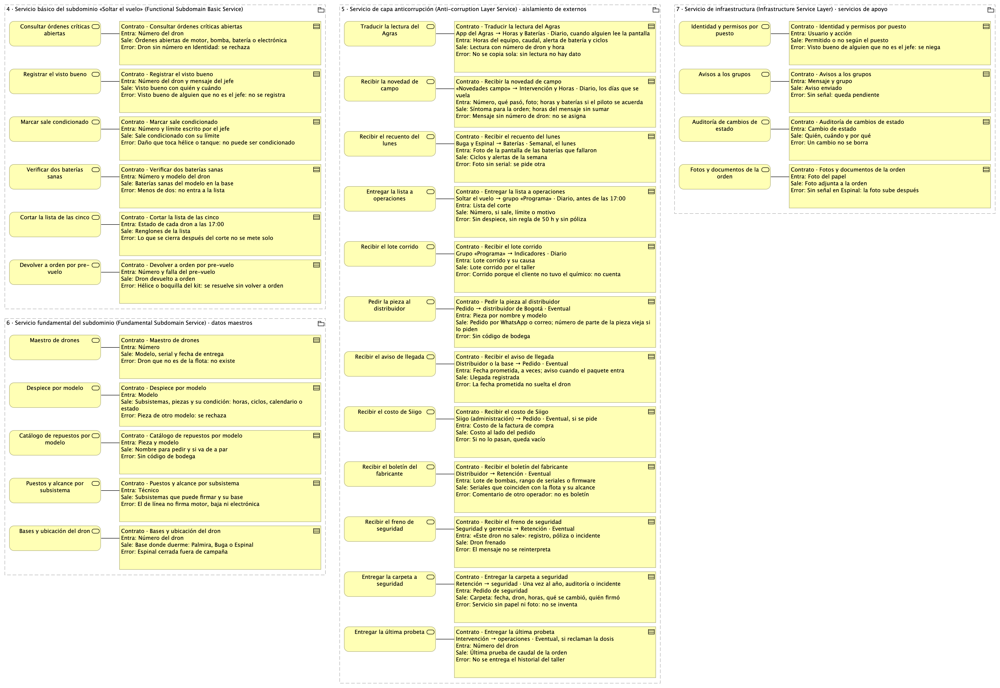

La misma idea para lo que no cabe en V4b. A la izquierda, los seis básicos de Soltar el vuelo y los cinco de datos maestros. A la derecha, la anticorrupción: ahí el contrato agrega dirección y frecuencia, porque el dato cruza de sistema. Abajo de esa columna, la infraestructura.

Los básicos protegen la regla. Consultar órdenes críticas rechaza un dron sin número. El visto bueno de alguien que no es el jefe no se registra. El condicionado que toca hélice o tanque se niega. Menos de dos baterías sanas no entra a la lista. Lo cerrado después de las cinco no se mete solo. Una hélice del kit se resuelve sin volver a orden.

En la anticorrupción el ritmo es el de la entrevista: la pantalla se lee a diario, el recuento de Buga y Espinal es el lunes, la lista sale antes de las 17:00, el costo y el boletín son eventuales, la carpeta va una vez al año o si hubo incidente. El mensaje de seguridad no se reinterpreta. Un comentario de otro operador no es un boletín.

## 5. Dominios y lenguaje ubicuo

Los dominios no se cortaron por pieza. Se cortaron por la decisión, sacando del proceso los objetos, los pasos y los eventos que cambian juntos.

### V5 Dominios

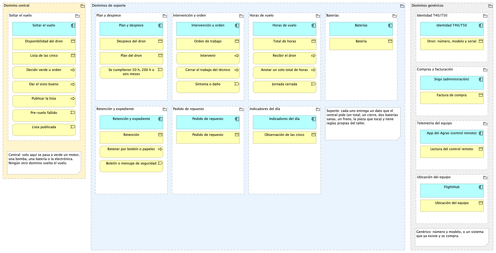

V5 clasifica. No es el mapa de contextos: aquí no hay flecha de un dominio a otro. Cada caja es el cúmulo que salió del proceso, con su componente de aplicación y lo que se extrajo (objeto, paso o evento). El patrón entre contextos está en V8.

| Dominio | Clase | De qué se extrajo | Argumento |
|---|---|---|---|
| Soltar el vuelo | Central | Disponibilidad, lista, decidir, visto bueno, publicar, pre-vuelo fallido, lista publicada | Solo aquí se pasa a verde un motor, una bomba, una batería o la electrónica |
| Plan y despiece | Soporte | Despiece, plan, evento de 50 h, 200 h o seis meses | Dice qué pieza toca y cuándo vence. No suelta el vuelo |
| Intervención y orden | Soporte | Orden, intervenir, cerrar, síntoma | Cierra el trabajo. No pone el verde crítico |
| Horas de vuelo | Soporte | Total de horas, recibir, anotar, jornada cerrada | Entrega un solo total. No decide si sale |
| Baterías | Soporte | La batería | Dice si hay dos sanas. La baja la firma el jefe |
| Retención y expediente | Soporte | Retención, el proceso de retener, el boletín | Obedece el freno. No radica |
| Pedido de repuesto | Soporte | El pedido | Pide por nombre y modelo. Si no llegó, el dron sigue en orden |
| Indicadores del día | Soporte | La observación de las cinco | Mira el resultado. No publica cero |
| Identidad T40/T50 | Genérico | Número, modelo y serial | Se construye pequeño y lo comparten todos |
| Compras y facturación | Genérico | Siigo y la factura de compra | Ya está comprado |
| Telemetría del equipo | Genérico | La app del Agras y la lectura del control | La da el fabricante |
| Ubicación del equipo | Genérico | FlightHub | Es de operaciones. El taller no lo integra |

### V7 Lenguaje ubicuo

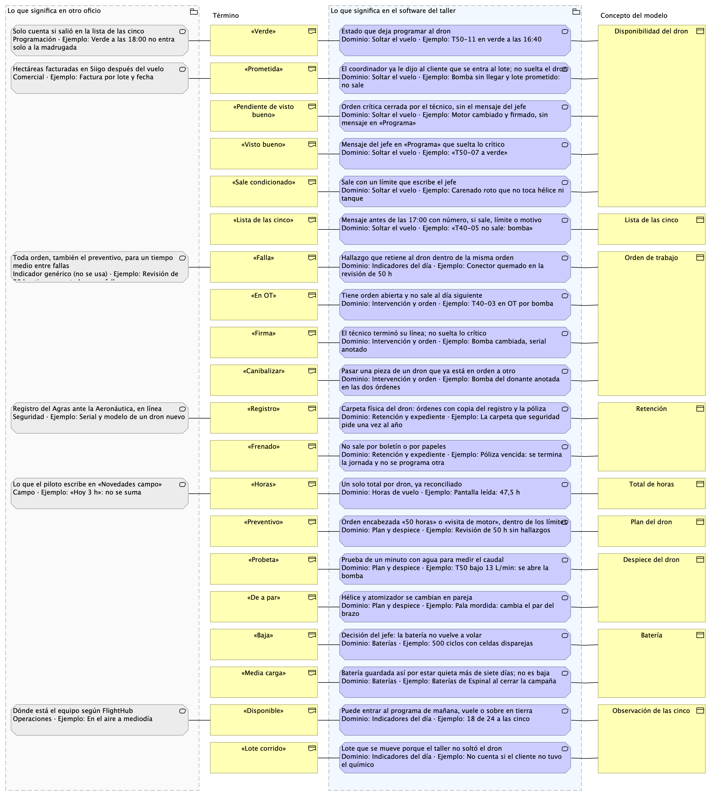

A la izquierda, lo que la misma palabra significa en otro oficio. Al centro, el término tal como se dice. A la derecha, el significado que va a usar el software, con su dominio y un ejemplo, y el concepto del modelo al que corresponde.

Seis palabras cambian de oficio. El resto tiene un solo significado y por eso no tienen caja gris.

| Se dice | En el software del taller | No significa |
|---|---|---|
| Disponible | Puede entrar al programa de mañana, vuele o sobre en tierra | Dónde está el equipo en FlightHub a mediodía |
| Horas | Un solo total ya reconciliado | Lo que el piloto escribe en «Novedades campo» |
| Verde | Estado que deja programar al dron | Un verde de las 18:00, que no entra solo a la madrugada |
| Falla | Hallazgo que retiene al dron dentro de la misma orden | El preventivo a tiempo, contado para un tiempo medio entre fallas |
| Registro | La carpeta física: órdenes, copia del registro y la póliza | El registro del Agras ante la Aeronáutica |
| Prometida | El coordinador ya le dijo al cliente que se entra al lote. No suelta el dron | Las hectáreas facturadas en Siigo |

Las que tienen un solo sentido en el taller: en OT, pendiente de visto bueno, visto bueno, firma, sale condicionado, frenado, lista de las cinco, preventivo, probeta, de a par, canibalizar, baja, media carga y lote corrido. La firma cierra la línea y no suelta lo crítico. El visto bueno es el mensaje del jefe en «Programa». Canibalizar es pasar una pieza de un dron que ya está en orden, anotada en las dos órdenes. Media carga no es baja: es cómo se guarda una batería quieta más de siete días.

## 6. Agregados, comandos y eventos

Hay un agregado por decisión que el software tiene que proteger, no uno por cada pieza del dron. La hélice y la boquilla viven como líneas de la orden y como piezas del despiece. Quién puede poner el verde lo protege Disponibilidad.

En cada vista V6 la raíz es el objeto de datos, marcada como raíz del agregado. Adentro están las entidades y los objetos de valor. La nota amarilla es la invariante: una flecha no puede decir «esto no puede pasar». El comando, en azul, dispara el evento, en amarillo. A la izquierda entra lo que dispara otro agregado. A la derecha sale a quién dispara este.

### V6a Soltar el vuelo

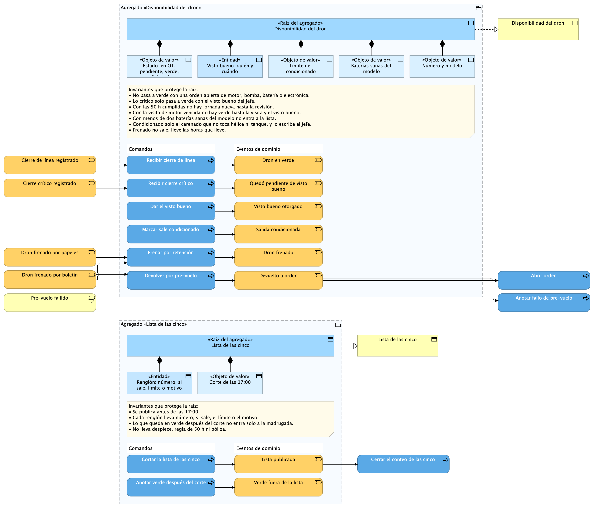

Dos agregados. La disponibilidad guarda el estado, el visto bueno, el límite, las baterías sanas y el número. La lista de las cinco guarda el renglón y el corte de las 17:00.

No pasa a verde con una orden abierta de motor, bomba, batería o electrónica. Lo crítico solo pasa con el visto bueno. Con las 50 h cumplidas no hay jornada nueva. Con la visita de motor vencida no hay verde hasta la visita y el visto bueno. Con menos de dos baterías sanas no entra a la lista. Condicionado solo el carenado que no toca hélice ni tanque, y lo escribe el jefe. Frenado no sale, lleve las horas que lleve.

| Comando | Evento |
|---|---|
| Recibir cierre de línea | Dron en verde |
| Recibir cierre crítico | Quedó pendiente de visto bueno |
| Dar el visto bueno | Visto bueno otorgado |
| Marcar sale condicionado | Salida condicionada |
| Frenar por retención | Dron frenado |
| Devolver por pre-vuelo | Devuelto a orden |
| Cortar la lista de las cinco | Lista publicada |
| Anotar verde después del corte | Verde fuera de la lista |

### V6b Intervención y orden

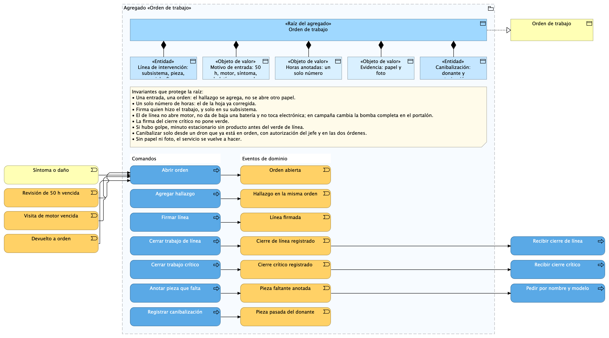

Raíz: la orden. Adentro: la línea, el motivo de entrada, un solo número de horas, el papel y la foto, y la canibalización.

Una entrada, una orden. El hallazgo se agrega, no se abre otro papel. Firma quien hizo el trabajo, y solo en su subsistema. La firma del cierre crítico no pone verde. Si hubo golpe, minuto estacionario sin producto antes del verde de línea. Canibalizar solo desde un dron que ya está en orden, con autorización del jefe y en las dos órdenes.

| Comando | Evento | Hacia dónde sale |
|---|---|---|
| Abrir orden | Orden abierta | |
| Agregar hallazgo | Hallazgo en la misma orden | |
| Firmar línea | Línea firmada | |
| Cerrar trabajo de línea | Cierre de línea registrado | Recibir cierre de línea |
| Cerrar trabajo crítico | Cierre crítico registrado | Recibir cierre crítico |
| Anotar pieza que falta | Pieza faltante anotada | Pedir por nombre y modelo |
| Registrar canibalización | Pieza pasada del donante | |

### V6c Horas de vuelo

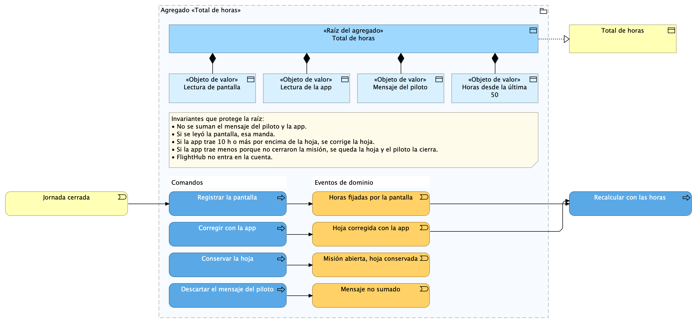

Raíz: el total de horas. Adentro: la pantalla, la app, el mensaje del piloto y las horas desde la última 50. Los tres entran. Sale uno.

No se suman el mensaje y la app. Si se leyó la pantalla, esa manda. Si la app trae 10 h o más por encima, se corrige la hoja. Si trae menos porque no cerraron la misión, se queda la hoja. FlightHub no entra. El total fijado o corregido dispara el recálculo del plan.

| Comando | Evento |
|---|---|
| Registrar la pantalla | Horas fijadas por la pantalla |
| Corregir con la app | Hoja corregida con la app |
| Conservar la hoja | Misión abierta, hoja conservada |
| Descartar el mensaje del piloto | Mensaje no sumado |

### V6d Baterías

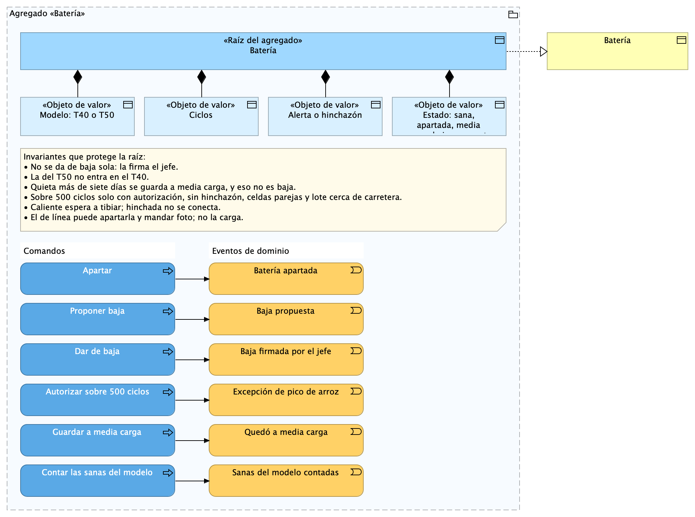

Raíz: la batería. Adentro: modelo, ciclos, alerta o hinchazón, y el estado.

No se da de baja sola. La del T50 no entra en el T40. Quieta más de siete días se guarda a media carga, y eso no es baja. Sobre 500 ciclos solo con autorización, sin hinchazón, celdas parejas y lote cerca de carretera. El de línea puede apartarla y mandar foto; no la carga.

| Comando | Evento |
|---|---|
| Apartar | Batería apartada |
| Proponer baja | Baja propuesta |
| Dar de baja | Baja firmada por el jefe |
| Autorizar sobre 500 ciclos | Excepción de pico de arroz |
| Guardar a media carga | Quedó a media carga |
| Contar las sanas del modelo | Sanas del modelo contadas |

### V6e Indicadores del día

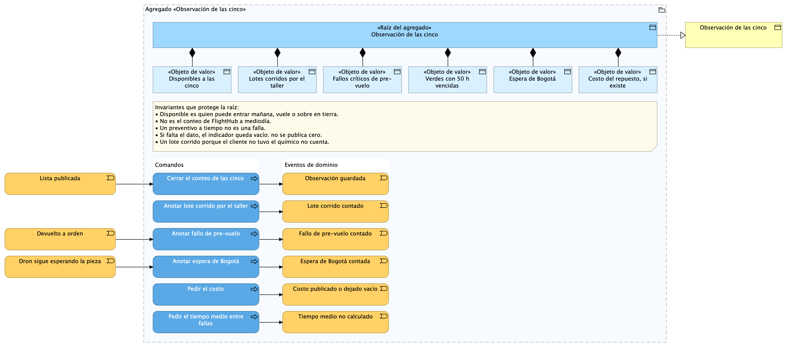

Raíz: la observación de las cinco. Adentro: disponibles, lotes corridos por el taller, fallos críticos de pre-vuelo, verdes con 50 h vencidas, espera de Bogotá y el costo si existe.

Disponible es quien puede entrar mañana, en el aire o sobrando en tierra. No es el conteo de FlightHub. Un preventivo a tiempo no es una falla. Si falta el dato, el indicador queda vacío. Un lote corrido porque el cliente no tuvo el químico no cuenta. Pedir el tiempo medio entre fallas se rechaza: el jefe no lo calcula y un cero diría que no hubo fallas.

| Comando | Evento |
|---|---|
| Cerrar el conteo de las cinco | Observación guardada |
| Anotar lote corrido por el taller | Lote corrido contado |
| Anotar fallo de pre-vuelo | Fallo de pre-vuelo contado |
| Anotar espera de Bogotá | Espera de Bogotá contada |
| Pedir el costo | Costo publicado o dejado vacío |
| Pedir el tiempo medio entre fallas | Tiempo medio no calculado |

### V6f Retención y expediente

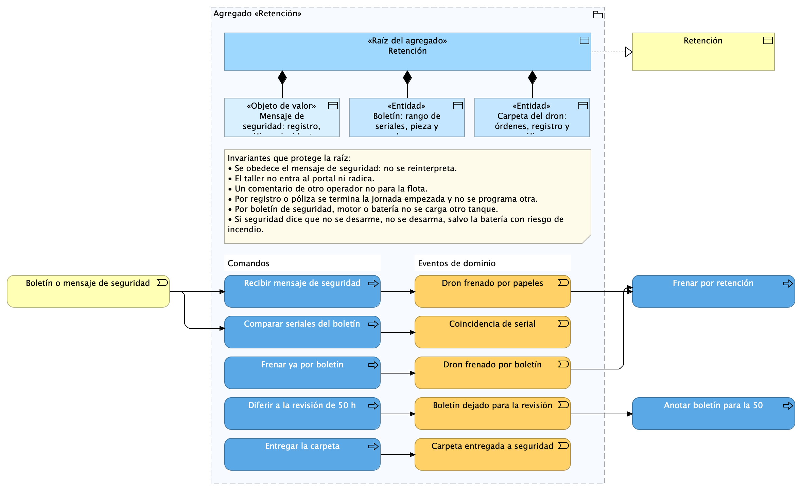

Raíz: la retención. Adentro: el mensaje de seguridad, el boletín con sus seriales y la carpeta.

Se obedece el mensaje. El taller no entra al portal. Un comentario de otro operador no para la flota. Por registro o póliza se termina la jornada empezada y no se programa otra. Por boletín de seguridad, motor o batería no se carga otro tanque. Si seguridad dice que no se desarme, no se desarma, salvo la batería con riesgo de incendio. El boletín que dice «en la próxima 50» no frena ese día: se anota en el plan.

| Comando | Evento |
|---|---|
| Recibir mensaje de seguridad | Dron frenado por papeles |
| Comparar seriales del boletín | Coincidencia de serial |
| Frenar ya por boletín | Dron frenado por boletín |
| Diferir a la revisión de 50 h | Boletín dejado para la revisión |
| Entregar la carpeta | Carpeta entregada a seguridad |

### V6g Pedido de repuesto

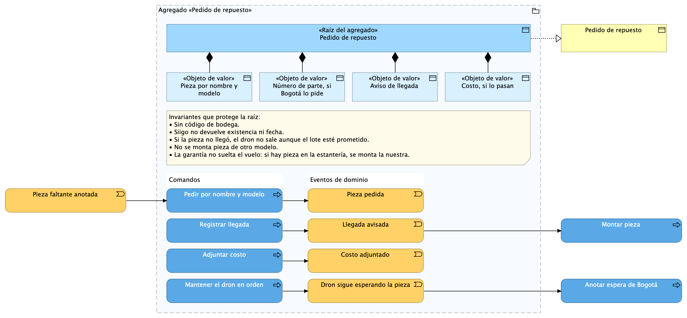

Raíz: el pedido. Adentro: nombre y modelo, el número de parte si Bogotá lo pide, el aviso de llegada y el costo si lo pasan.

Sin código de bodega. Siigo no devuelve existencia ni fecha. Si la pieza no llegó, el dron no sale aunque el lote esté prometido. No se monta pieza de otro modelo. La garantía no suelta el vuelo: si hay pieza en la estantería, se monta la nuestra. La llegada dispara montar la pieza en el despiece. La espera se cuenta en los indicadores.

| Comando | Evento |
|---|---|
| Pedir por nombre y modelo | Pieza pedida |
| Registrar llegada | Llegada avisada |
| Adjuntar costo | Costo adjuntado |
| Mantener el dron en orden | Dron sigue esperando la pieza |

### V6h Plan y despiece

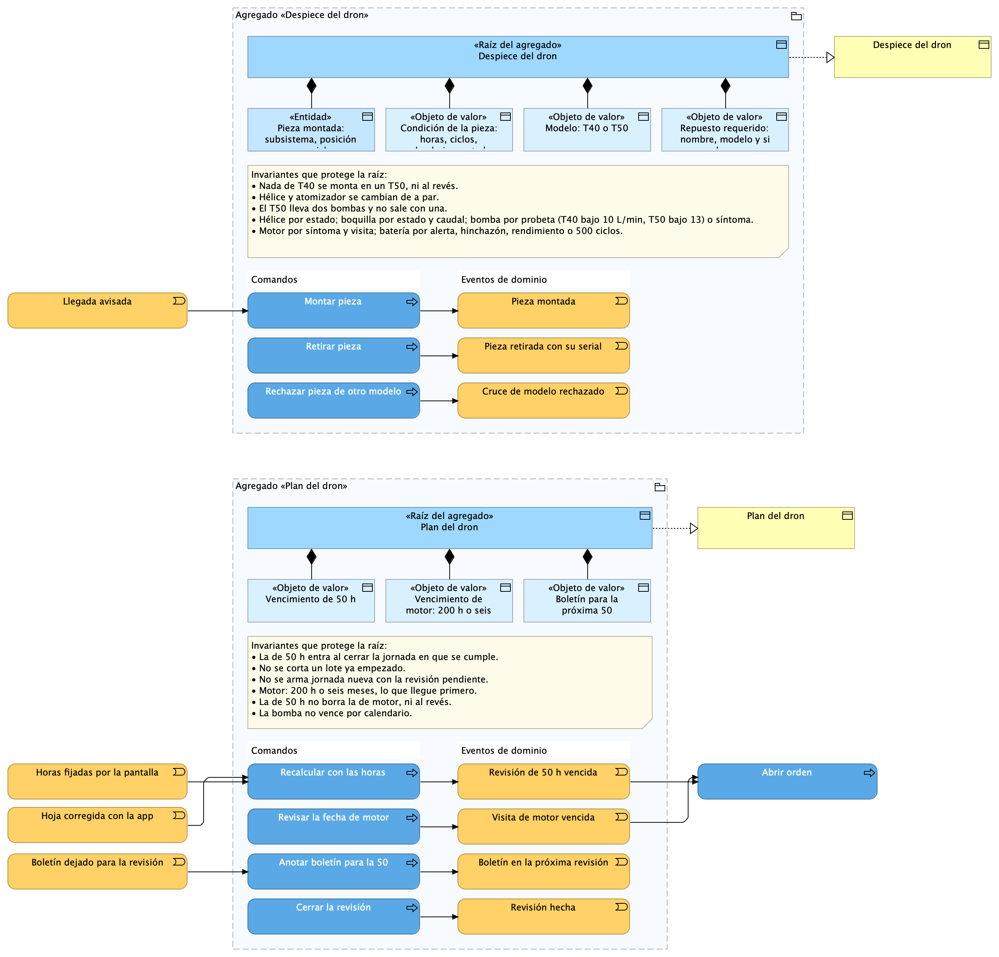

Dos agregados. El despiece guarda la pieza montada, su condición, el modelo y el repuesto que toca pedir. El plan guarda el vencimiento de 50 h, el de motor y el boletín dejado para esa revisión.

Nada de T40 se monta en un T50, ni al revés. Hélice y atomizador se cambian de a par. El T50 lleva dos bombas y no sale con una. La bomba se abre si la probeta baja de 10 L/min en el T40 o de 13 en el T50. La de 50 h entra al cerrar la jornada en que se cumple. No se corta un lote ya empezado y no se arma jornada nueva con la revisión pendiente. En el motor gana lo que llegue primero, 200 h o seis meses. La de 50 h no borra la de motor. La bomba no vence por calendario.

| Comando | Evento |
|---|---|
| Montar pieza | Pieza montada |
| Retirar pieza | Pieza retirada con su serial |
| Rechazar pieza de otro modelo | Cruce de modelo rechazado |
| Recalcular con las horas | Revisión de 50 h vencida |
| Revisar la fecha de motor | Visita de motor vencida |
| Anotar boletín para la 50 | Boletín en la próxima revisión |
| Cerrar la revisión | Revisión hecha |

La revisión vencida abre la orden. Las horas fijadas o corregidas disparan el recálculo.

### V6i Identidad T40/T50

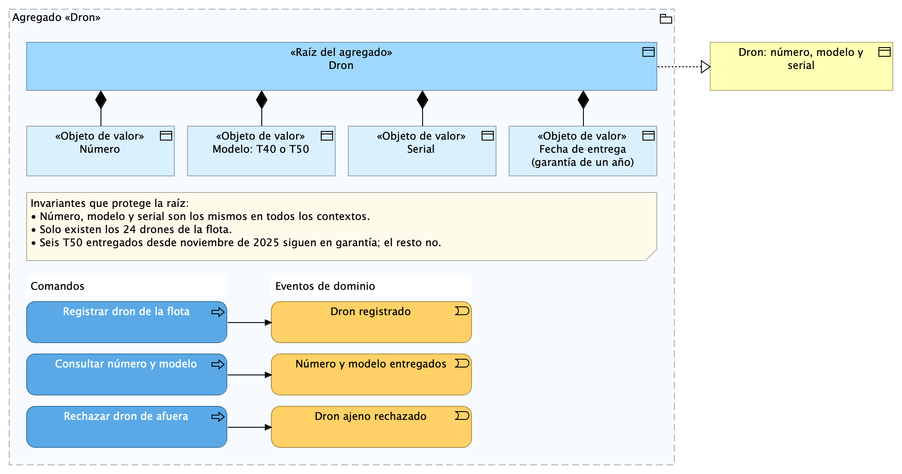

Raíz: el dron. Adentro: número, modelo, serial y fecha de entrega.

Número, modelo y serial son los mismos en todos los contextos. Solo existen los 24 drones de la flota. Seis T50 entregados desde noviembre de 2025 siguen en garantía de un año; el resto no. Un dron de afuera se rechaza.

| Comando | Evento |
|---|---|
| Registrar dron de la flota | Dron registrado |
| Consultar número y modelo | Número y modelo entregados |
| Rechazar dron de afuera | Dron ajeno rechazado |

## 7. Mapa de contextos e interoperabilidad

### V8 Mapa de contextos

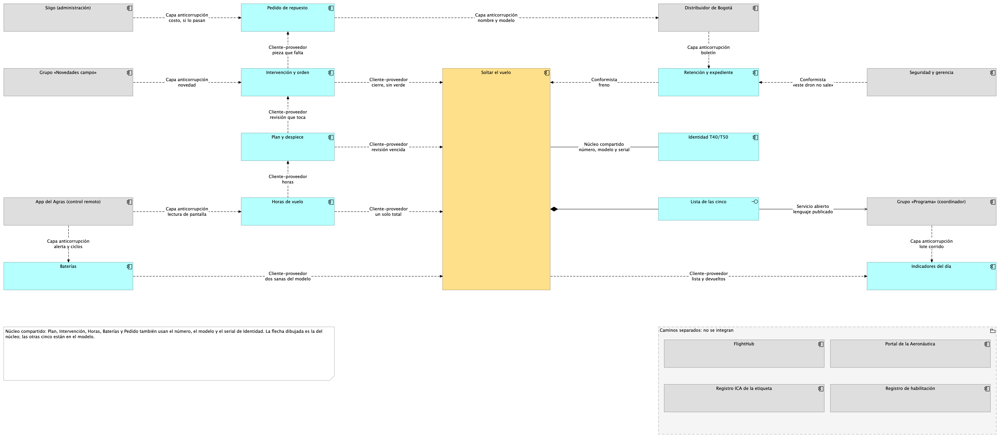

V8 nombra el patrón en la flecha. La flecha va del proveedor al cliente. Cada flecha es recta y el nombre cabe en el hueco, en dos renglones: el patrón y el dato. Soltar el vuelo está al centro. A la izquierda, quien le entrega algo. A la derecha, quien recibe la lista, el freno o el número.

| De | A | Patrón | Dato |
|---|---|---|---|
| Horas, Plan, Intervención, Baterías | Soltar el vuelo | Cliente-proveedor | Un solo total, la revisión vencida, el cierre sin verde, dos sanas del modelo |
| Horas | Plan | Cliente-proveedor | Las horas, para recalcular |
| Plan | Intervención | Cliente-proveedor | La revisión que toca |
| Intervención | Pedido | Cliente-proveedor | La pieza que falta |
| Soltar el vuelo | Indicadores | Cliente-proveedor | La lista y los devueltos |
| Retención | Soltar el vuelo | Conformista | El freno no se reinterpreta |
| Seguridad | Retención | Conformista | «Este dron no sale» |
| App del Agras, Novedades, Siigo, Distribuidor, Programa | El contexto que traduce | Capa anticorrupción | Pantalla, alerta, novedad, costo, nombre y modelo, boletín, lote corrido |
| Lista de las cinco | Grupo «Programa» | Servicio abierto | Lenguaje publicado: número, si sale, límite o motivo |
| Identidad | Soltar el vuelo | Núcleo compartido | Número, modelo y serial |

Plan, Intervención, Horas, Baterías y Pedido también usan ese núcleo. Esas cinco asociaciones están en el modelo y no se dibujaron: cinco flechas más al mismo punto volvían a montar los nombres. La nota de la vista lo dice. Tres flujos quedan solo en el modelo, por la misma razón: el boletín diferido a la 50, que va de Retención al Plan; la llegada de la pieza, que va de Pedido al Plan; y la espera de Bogotá, que va de Pedido a Indicadores. En el dibujo se leen en V6, donde el evento de un agregado dispara el comando del otro.

FlightHub, el portal, el ICA y la habilitación están en el grupo «Caminos separados». Con esos no se intercambia nada.

### V9 Interoperabilidad y anticorrupción

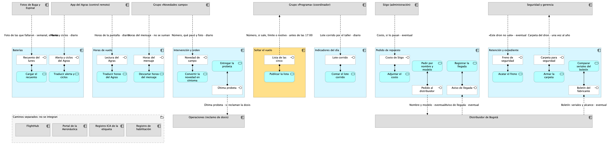

Cada intercambio es una interfaz y un servicio de aplicación, metidos en el contexto que traduce. La flecha dice el dato y el ritmo. El servicio de aplicación realiza el servicio de negocio de la capa anticorrupción de V4.

| De | A | Dato | Ritmo |
|---|---|---|---|
| Fotos de Buga y Espinal | Baterías | Las que fallaron | Semanal, el lunes |
| App del Agras | Baterías | Alerta y ciclos | Diario |
| App del Agras | Horas | Horas de la pantalla | Diario |
| Novedades campo | Horas | Horas del mensaje, que no se suman | Diario |
| Novedades campo | Intervención | Número, qué pasó y foto | Diario |
| Soltar el vuelo | Grupo «Programa» | Número, si sale, límite o motivo | Antes de las 17:00 |
| Grupo «Programa» | Indicadores | Lote corrido por el taller | Diario |
| Siigo | Pedido | Costo, si lo pasan | Eventual |
| Seguridad | Retención | «Este dron no sale» | Eventual |
| Retención | Seguridad | Carpeta del dron | Una vez al año |
| Intervención | Operaciones | Última probeta, si reclaman la dosis | Eventual |
| Pedido | Distribuidor | Nombre y modelo | Eventual |
| Distribuidor | Pedido | Aviso de llegada | Eventual |
| Distribuidor | Retención | Boletín: seriales y alcance | Eventual |

El mismo grupo de caminos separados de V8 está abajo. Dibujarlos con una línea de «no hay flujo» hacía parecer que sí había intercambio.

## 8. Bounded Context Canvas

### V11 Canvas

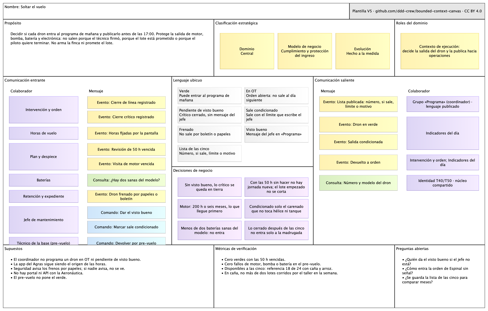

El canvas es una vista de Archi, del tipo Canvas, no un tablero aparte. Sigue las secciones del Bounded Context Canvas: nombre, propósito, clasificación estratégica, rol, comunicación entrante, lenguaje, decisiones, comunicación saliente, supuestos, métricas y preguntas abiertas.

| Bloque | Qué dice |
|---|---|
| Propósito | Decidir si cada dron entra al programa de mañana y publicarlo antes de las 17:00. No arma la finca ni promete el lote |
| Clasificación | Dominio central. Modelo de negocio: cumplimiento y protección del ingreso. Evolución: hecho a la medida |
| Rol | Contexto de ejecución: decide la salida y la publica hacia operaciones |
| Lenguaje | Verde, en OT, pendiente de visto bueno, sale condicionado, frenado, visto bueno, lista de las cinco |
| Entrante | Cierres de Intervención, horas fijadas, revisión vencida, consulta de dos baterías sanas, freno, visto bueno del jefe, devolución por pre-vuelo |
| Saliente | Lista publicada hacia «Programa», en lenguaje publicado. Verde y condicionado hacia Indicadores. Devuelto a orden hacia Intervención. Consulta de número y modelo a Identidad |
| Decisiones | Sin visto bueno, lo crítico se queda. Con las 50 h sin hacer no hay jornada nueva. Motor: 200 h o seis meses, lo primero. Condicionado solo el carenado. Menos de dos baterías: no entra. Lo de después de las cinco no entra solo |
| Supuestos | El coordinador no programa un dron en OT ni pendiente. La app sigue siendo el origen de las horas. Si seguridad no avisa, el freno no se ve. No hay portal. El pre-vuelo no pone el verde |
| Métricas | Cero verdes con las 50 h vencidas. Cero fallos de motor, bomba o batería en el pre-vuelo. Referencia 18 de 24 a las cinco. En caña, no más de dos lotes corridos por el taller en la semana |
| Preguntas abiertas | ¿Quién da el visto bueno si el jefe no está? ¿Cómo entra la orden de Espinal sin señal? ¿Se guarda la lista para comparar meses? |

## 9. Decisiones y supuestos

### V10 Trazabilidad vertical

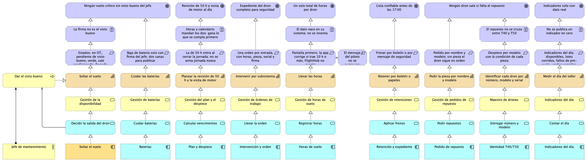

Cada columna baja de la meta al componente, en vertical, para que la relación no cruce el dibujo. El orden, de arriba abajo, es meta, principio cuando existe, requerimiento, capacidad, servicio de negocio, servicio de aplicación y componente. El componente realiza el servicio de aplicación, ese realiza el de negocio, ese realiza la capacidad y esa realiza el requerimiento.

| Columna | Componente | Llega a |
|---|---|---|
| Soltar el vuelo | Decidir la salida | Meta del visto bueno, por el principio «la firma no es el visto bueno» |
| Baterías | Cuidar baterías | La misma meta, por la baja y las dos sanas |
| Plan | Calcular vencimientos | Meta del plan, por «horas y calendario mandan los dos» |
| Orden | Llevar la orden | Expediente completo |
| Horas | Registrar horas | Un solo total. Al lado, la restricción de no sumar el mensaje empuja en contra de saltarse el requerimiento |
| Retención | Aplicar frenos | La lista confiable, porque un frenado no entra |
| Pedido | Pedir repuestos | Ningún dron sale si falta la pieza |
| Identidad | Entregar número y modelo | La misma meta, por «el repuesto no se cruza» |
| Indicadores | Contar el día | Indicadores solo con dato real |

A la izquierda, el jefe se asigna a «dar el visto bueno» y ese proceso realiza la capacidad de soltar el vuelo. El servicio de aplicación le sirve a ese proceso. Así se ve que la columna no es solo software: el acto sigue siendo del jefe.

Reglas que el modelo no afloja, aunque no quepan como una flecha más:

- Horas y calendario mandan los dos. En el motor gana lo que se cumpla primero.
- En el banco, el T40 se abre si la bomba baja de 10 L/min. El T50, si baja de 13. Hélice y atomizador se cambian de a par.
- El de línea no abre motor, no da de baja una batería y no toca electrónica. En campaña puede cambiar la bomba completa en el portalón, sin abrir el cuerpo, y el verde espera al jefe.
- La lista de las cinco no mete sola, a la madrugada, un dron que quedó en verde después de esa hora.
- Seis T50 entregados desde noviembre de 2025 siguen en garantía de un año. Los otros diez y los ocho T40 no. El preventivo no abre ese trámite. Si hay pieza en la estantería, se monta la nuestra y la mala queda apartada. Si se sospecha garantía de motor, sale entero, sin abrir.

Supuestos que el jefe dio por ciertos y el diseño no discute:

- El coordinador no programa un dron que siga en orden o pendiente de visto bueno.
- La app del Agras sigue siendo el origen de las horas. El software no las inventa.
- No hay API con la Aeronáutica. El expediente lo sigue sacando seguridad.
- La existencia se ve en la estantería o la confirma la base.
- El alcance del técnico es el puesto, no una licencia que venza en un registro.

### Aportes

Nicolás Agudelo, Nicolás Buitrago, Esteban Alvarez y Sebastian Bedoya responden por el diseño completo. No hay una vista asignada a una persona. La entrevista, la motivación, las capacidades, el proceso, los servicios, los dominios, los agregados, los contextos, la interoperabilidad y el canvas los tiene que poder explicar cualquiera.

El repositorio se publica desde la cuenta de Nicolás Agudelo. Ese dato del historial no reparte el trabajo.
